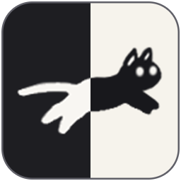
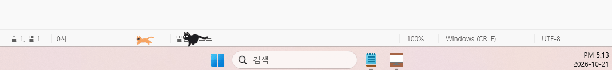
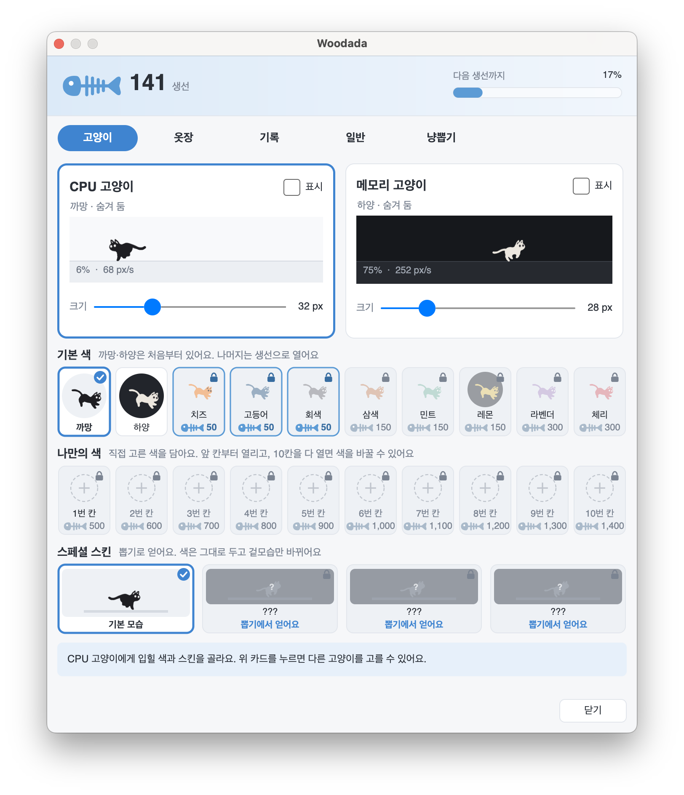

🌐 <a href="README.md">English</a> · <b>한국어</b>

<h1><b>Woodada</b></h1>

**작업표시줄 위를 우다다 달리는 고양이**

컴퓨터가 바쁠수록 고양이도 더 빨리 달려요.

    

 

  

<!-- 앱 아이콘처럼 왼쪽 검정(Windows)·오른쪽 크림(macOS) 반반 버튼. 두 링크 사이에 공백이 없어야 한 알약처럼 붙는다. -->

인텔 맥은 [여기](https://github.com/Hyuntae-Jeong/Woodada/releases/latest/download/Woodada-mac-x64.dmg)에서 받으세요

 

## 🐈 이런 앱이에요

- 🏃 **바쁠수록 빨라지는 고양이** — CPU 고양이와 메모리 고양이가 작업표시줄(맥은 독) 위를 왔다 갔다 달려요.
- 🐟 **달린 만큼 생선** — 고양이가 달리면 생선이 쌓이고, 생선으로 새 색과 새 친구를 데려와요.
- 🎨 **내 맘대로 꾸미기** — 고양이마다 색 20가지 중에 고르고, 크기도 바꿀 수 있어요.
- 🎰 **냥뽑기** — 생선을 모아 특별한 고양이를 뽑아 보세요.
- 📏 **오늘 몇 km 달렸을까** — 모니터 실제 크기로 계산해 "오늘 1.2 km 달렸어요"처럼 알려 줘요.
- 🪶 **방해하지 않아요** — 고양이 위를 클릭해도 아래 창이 그대로 눌리고, 게임·발표처럼 전체 화면일 땐 알아서 숨어요.
- 🔄 **알아서 최신 버전** — 새 버전이 나오면 스스로 업데이트해요.

  

### 🎰 냥뽑기에서 만날 수 있는 고양이

| | 고양이 | 모습 |
|:-:|---|---|
| ★★ | **유령냥** | 반투명한 몸으로 둥실둥실 떠다녀요 |
| ★★★ | **플래시냥** | 지나온 길에 잔상과 불꽃을 남겨요. 빠를수록 꼬리가 길어져요 |
| ★★★★ | **글리치냥** | 가끔 화면이 고장 난 것처럼 지지직거려요 |

닥스훈트와 토끼도 곧 함께 달릴 예정이에요. 🐕 🐇

 

## 📥 설치

### Windows

1. 위의 **Windows** 버튼으로 `Woodada.exe`를 받아요.
2. 바탕 화면처럼 편한 곳에 두고 더블클릭하면 끝! 따로 설치할 건 없어요.
3. 작업표시줄에 고양이가 나타나요. 오른쪽 아래 트레이의 고양이 아이콘을 누르면 설정이 열려요.

> [!TIP]
> "Windows의 PC 보호" 창이 뜨면 **추가 정보 → 실행**을 누르세요.
> `Program Files`처럼 권한이 필요한 폴더에 두면 자동 업데이트가 되지 않아요.

### macOS

1. 위의 **macOS** 버튼으로 `.dmg`를 받아요. (인텔 맥은 버튼 아래 링크)
2. `.dmg`를 열고 Woodada를 응용 프로그램 폴더로 끌어다 놓아요.
3. 실행하면 독 위에 고양이가 나타나요. 메뉴 막대의 고양이 아이콘으로 설정을 열 수 있어요.

> [!TIP]
> 처음 열 때 "확인되지 않은 개발자" 경고가 뜨면 **시스템 설정 → 개인정보 보호 및 보안**에서 **그래도 열기**를 누르세요. 한 번만 하면 돼요.

 

## 💬 자주 묻는 질문

<b>컴퓨터 켤 때 같이 켜지게 할 수 있나요?</b>

 

네. 트레이(맥은 메뉴 막대) 아이콘 메뉴에서 **Windows 시작 시 실행**(맥은 **로그인 시 실행**)을 켜 주세요.

<b>업데이트는 어떻게 하나요?</b>

 

할 필요 없어요. 앱이 켜질 때마다 새 버전을 확인해서 알아서 바꿔 끼워요.

<b>모니터가 여러 대인데요?</b>

 

설정의 **일반** 탭에서 고양이가 달릴 모니터를 고를 수 있어요. 작업표시줄이 위·아래·왼쪽·오른쪽 어디에 있어도 따라 달려요.

<b>macOS에서 독을 숨겨 뒀어요.</b>

 

독이 숨어 있거나 옆에 있으면 화면 바닥을 따라 달려요.

<b>지우고 싶어요.</b>

 

- **Windows** — 트레이 아이콘에서 종료한 뒤 `Woodada.exe`를 지우세요. 기록까지 지우려면 `%APPDATA%\Woodada` 폴더도 지우면 돼요.
- **macOS** — 메뉴 막대 아이콘에서 종료한 뒤 응용 프로그램 폴더의 Woodada를 휴지통에 버리세요. 기록은 `~/Library/Application Support/Woodada`에 있어요.

 

## 🙏 크레딧

고양이 그림은 [RunCat365](https://github.com/runcat-dev/RunCat365)(runcat-dev, Apache License 2.0)에서 가져왔어요.
닥스훈트와 토끼는 고양이 그림체에 맞춰 직접 그렸어요.

## 📄 라이선스

Woodada는 [MIT License](LICENSE)로 배포하는 무료 오픈소스예요. 단, 고양이 그림은 원본 라이선스(Apache License 2.0, `app/src/Woodada/Assets/RunCat/LICENSE`)를 따라요.
