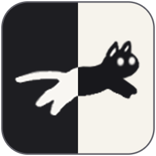
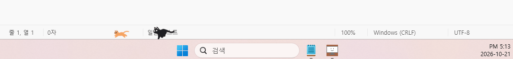

<div align="center">



<h1><b>Woodada</b></h1>

**작업표시줄·독 위를 우다다 달리는 CPU·메모리 고양이**

컴퓨터가 바빠질수록 고양이도 더 빨리 달립니다.

    

<br>


<br><br>

<!-- GitHub는 href가 #gh-light-mode-only / #gh-dark-mode-only로 끝나는 링크를 테마에 맞춰 숨긴다. # 뒤는 다운로드에 영향이 없다. -->
<a href="https://github.com/Hyuntae-Jeong/Woodada/releases/latest/download/Woodada.exe#gh-light-mode-only"></a><a href="https://github.com/Hyuntae-Jeong/Woodada/releases/latest/download/Woodada.exe#gh-dark-mode-only"></a>

macOS: [애플 실리콘용 .dmg](https://github.com/Hyuntae-Jeong/Woodada/releases/latest/download/Woodada-mac-arm64.dmg) · [인텔 맥용 .dmg](https://github.com/Hyuntae-Jeong/Woodada/releases/latest/download/Woodada-mac-x64.dmg)

</div>

<br>

## ✨ 특징

- 🐈 **CPU 고양이 · 메모리 고양이** — 사용률이 높을수록 빨리 달리고, 화면 끝에 닿으면 돌아서 왕복합니다.
- 🐟 **생선 보상** — 고양이가 달린 만큼 생선이 쌓이고, 생선으로 새 색과 새 러너를 잠금 해제합니다.
- 🎨 **고양이 꾸미기** — 고양이마다 색(기본 팔레트 10칸 + 직접 고르는 나만의 색 10칸)과 크기(16~72px)를 따로 정하고, 미리보기로 바로 확인합니다.
- 🖥️ **멀티 모니터** — 달릴 모니터를 고를 수 있고, 작업표시줄이 아래·위·왼쪽·오른쪽 어디에 있어도 그 가장자리를 따라 달립니다.
- 🍎 **macOS 지원** — 독이 보이면 독 위를, 독을 숨겨 두면 화면 바닥을 달립니다. 독이 왼쪽·오른쪽에 있으면 독을 피해 화면 바닥을 달립니다.
- 🎮 **전체 화면에서는 숨기** — 게임이나 발표 중에는 알아서 사라집니다(macOS는 전체 화면 앱이 따로 데스크톱을 써서 늘 가려집니다).
- 🪶 **가볍게 상주** — 트레이 아이콘(macOS는 메뉴 막대 아이콘)으로만 떠 있고, 클릭은 고양이를 통과해 아래 창으로 그대로 전달됩니다.
- 🔄 **자동 업데이트** — 켜질 때마다 새 릴리즈를 확인해, 있으면 알아서 바꿔 끼우고 다시 실행합니다(Windows). macOS는 새 버전이 나오면 알려 줍니다.
- 📏 **달린 거리 기록** — 모니터 실제 크기로 환산해 "오늘 1.2 km 달렸어요"처럼 고양이별·전체 거리를 보여줍니다.

## 🚀 시작하기

### 내려받기 (Windows)

[최신 `Woodada.exe`](https://github.com/Hyuntae-Jeong/Woodada/releases/latest/download/Woodada.exe)를 받아 원하는 폴더에 두고 실행합니다. 지난 버전은 [Releases](https://github.com/Hyuntae-Jeong/Woodada/releases)에 있습니다.
.NET 런타임까지 exe 하나에 들어 있어서 따로 설치할 것은 없습니다.

그다음부터는 켜질 때마다 새 버전이 있는지 확인해 묻지 않고 업데이트합니다.
exe는 쓰기 권한이 있는 폴더(예: 바탕 화면, `%LOCALAPPDATA%`)에 두세요. `Program Files`처럼 권한이 없는 곳에서는 업데이트를 건너뜁니다.
확인·업데이트 기록은 `%APPDATA%\Woodada\update.log`에 남습니다.

### 내려받기 (macOS)

애플 실리콘(M1 이후)은 [`Woodada-mac-arm64.dmg`](https://github.com/Hyuntae-Jeong/Woodada/releases/latest/download/Woodada-mac-arm64.dmg), 인텔 맥은 [`Woodada-mac-x64.dmg`](https://github.com/Hyuntae-Jeong/Woodada/releases/latest/download/Woodada-mac-x64.dmg)를 받아 열고, Woodada를 응용 프로그램 폴더로 끌어다 놓습니다.

- Apple 개발자 서명이 없어서 처음 열 때 "확인되지 않은 개발자" 경고가 뜹니다. 시스템 설정 → 개인정보 보호 및 보안에서 **그래도 열기**를 누르세요.
  터미널에서 `xattr -dr com.apple.quarantine /Applications/Woodada.app`을 실행해도 됩니다.
- 독에는 아이콘이 생기지 않고 메뉴 막대에만 아이콘이 생깁니다.
- 아직 자동 업데이트는 없고, 새 버전이 나오면 알림과 메뉴 막대 메뉴의 "새 버전 받기"로 알려 줍니다.
- 설정·기록은 `~/Library/Application Support/Woodada`에 저장됩니다.

### 직접 빌드하기

필요한 것:

- Windows 10 / 11 또는 macOS 12 이상
- [.NET 9 SDK](https://dotnet.microsoft.com/download/dotnet/9.0) (없으면 `dev.cmd`·`dev.sh`가 개발용 폴더에 받아 쓸지 물어봅니다)

#### 개발용으로 실행 (`dev.cmd`)

저장소 루트의 `dev.cmd`를 더블클릭하면 지금 소스를 Debug로 빌드해 **개발용 Woodada**를 설정 창과 함께 띄웁니다.
이미 떠 있는 개발용 앱은 닫고 새로 띄우므로, 고친 뒤 다시 누르기만 하면 됩니다.

```bash
.\dev.cmd
```

macOS에서는 `dev.sh`를 씁니다. 하는 일은 같습니다.

```bash
./dev.sh
```

개발용 앱(Debug 빌드)은 설치해서 쓰는 Woodada와 동시에 띄울 수 있도록 따로 동작합니다.

| | 설치된 앱 (Release) | 개발용 앱 (Debug) |
|---|---|---|
| 설정·달린 기록 | `%APPDATA%\Woodada` (macOS: `~/Library/Application Support/Woodada`) | 같은 곳의 `Woodada-dev` (처음 한 번 설치된 앱의 설정을 복사) |
| 시작 시 실행 | `Woodada` | `Woodada-dev` (서로 덮어쓰지 않음) |
| 자동 업데이트 | 함 | 안 함 |
| 표시 | — | 트레이·메뉴 막대 툴팁 `[DEV]`, 창 제목 "(개발용)" |

#### 바로 실행

```bash
dotnet run --project src/Woodada
```

설정 창을 바로 열고 싶으면 `--settings`를 붙입니다.

```bash
dotnet run --project src/Woodada -- --settings
```

#### exe 하나로 만들기 (Windows)

```bash
dotnet publish src/Woodada -c Release -r win-x64 --self-contained true -p:PublishSingleFile=true -p:IncludeNativeLibrariesForSelfExtract=true -p:EnableCompressionInSingleFile=true
```

`src/Woodada/bin/Release/net9.0/win-x64/publish/Woodada.exe`가 만들어집니다. 릴리즈와 같은 방식으로, .NET 런타임이 들어 있어 어느 PC에서나 exe 하나로 실행됩니다(약 46MB).

#### .app·.dmg 만들기 (macOS)

```bash
build/mac/build-app.sh osx-arm64
```

`publish/mac-osx-arm64/Woodada.app`과 `Woodada-mac-arm64.dmg`가 만들어집니다. 인텔 맥용은 `osx-x64`를 넘깁니다.

## 🕹️ 사용법

| 동작 | 결과 |
|---|---|
| 트레이 아이콘 **왼쪽 클릭** (Windows) | 설정 창 열기 |
| 트레이 아이콘 **오른쪽 클릭** (Windows) | 설정 · Windows 시작 시 실행 · 종료 |
| 메뉴 막대 아이콘 **클릭** (macOS) | 설정 · 로그인 시 실행 · 종료 |

**설정 창**

맨 위에 가진 생선 수와 다음 생선까지 남은 정도가 보입니다.

- **고양이** — CPU·메모리 고양이 카드(표시 여부, 실시간 미리보기, 크기)와 색 칸 20개. 카드를 눌러 고양이를 고르고, 칸을 눌러 색을 입히거나 입어 본 뒤 잠금 해제합니다.
- **옷장** — 러너 모음. 새 러너를 생선으로 데려와 고양이 대신 달리게 합니다. 준비 중인 닥스훈트·토끼는 "COMING SOON" 칸으로 먼저 보이고, 마우스를 올리면 달리기 연습하는 모습을 볼 수 있습니다.
- **기록** — 달린 거리와 모은 생선
- **일반** — 달릴 모니터, 전체 화면 앱 실행 중 숨기기(Windows)

**생선 보상**

| 항목 | 생선 |
|---|---|
| 몸 길이 1,000번 달리기 (기본 크기로 약 4만 px) | +1 |
| 기본 색 — 까망 · 하양 | 처음부터 있음 |
| 기본 색 — 치즈 · 고등어 · 회색 | 50 |
| 기본 색 — 삼색 · 민트 · 레몬 | 150 |
| 기본 색 — 라벤더 · 체리 | 300 |
| 나만의 색 칸 (앞 칸부터 차례로) | 500, 600, … 1,400 |
| 새 러너 (나온 순서대로) | 1,000, 2,000, 3,000 … |

- 픽셀이 아니라 몸 길이로 세므로 고양이를 키워도 생선이 빨리 쌓이지 않습니다. 평소(CPU 10%, 메모리 50%)에는 두 고양이를 합쳐 시간당 20개 남짓 모입니다.
- 생선은 따로 저장하지 않고 "지금까지 달린 몸 길이 ÷ 1,000 − 쓴 생선"으로 계산합니다. 그래서 보상이 생기기 전에 달린 기록도 생선이 됩니다.
- 보상이 생기기 전부터 쓰던 색은 처음 실행할 때 그대로 갖게 됩니다(직접 고른 색이었다면 나만의 색 1칸을 무료로).
- 잠긴 색은 사기 전에 입어 볼 수 있습니다. 칸을 누르면(나만의 색은 색을 고르면) 카드의 미리보기 고양이만 그 색으로 바뀌고, 안내 상자의 "사기" 버튼으로 삽니다. 생선이 모자라도 입어 보기는 됩니다.
- 나만의 색 칸의 색은 10칸을 모두 연 뒤에만 바꿀 수 있습니다(입고 있는 칸을 한 번 더 누르거나 오른쪽 클릭, 생선은 들지 않음). 그 전에는 칸을 열 때 고른 색 그대로입니다.

**기록 탭**

- 오늘 달린 거리와 지금까지 달린 거리를 고양이별·전체로 보여줍니다.
- 거리는 모니터가 알려주는 실제 패널 크기(Windows는 EDID, macOS는 CoreGraphics)를 지금 해상도로 나눠 1px의 길이를 구해 계산합니다. 크기를 알 수 없는 화면(TV·프로젝터·원격 데스크톱 등)은 화면 배율로 추정합니다.

설정은 바꾸는 즉시 반영되고 `%APPDATA%\Woodada\settings.json`(macOS는 `~/Library/Application Support/Woodada/settings.json`)에 저장됩니다. 달린 기록은 `%APPDATA%\Woodada\stats.json`에 30초마다, 그리고 종료할 때 저장됩니다. 잠금 해제한 색·러너와 쓴 생선은 `%APPDATA%\Woodada\rewards.json`에 살 때마다 저장됩니다.

## 🧩 구조

UI는 [Avalonia](https://avaloniaui.net/)로 만들어 Windows와 macOS가 같은 코드로 돌아갑니다.
OS마다 달라야 하는 일(어디서 달릴지, CPU·메모리 읽기, 클릭 통과 창, 시작 시 실행)만 `Platform/IPlatform` 뒤에 두고 OS별로 하나씩 구현합니다.

| 위치 | 역할 |
|---|---|
| `Platform/IPlatform` | OS마다 다른 일의 목록. 나머지 코드는 이것만 부른다 |
| `Platform/Windows/WindowsPlatform` | 작업표시줄(`Shell_TrayWnd` / `Shell_SecondaryTrayWnd`) 위치, `GetSystemTimes`·`GlobalMemoryStatusEx`, EDID, 레지스트리 시작 프로그램, 클릭 통과 창 스타일 |
| `Platform/Mac/MacPlatform` | 독 위치(NSScreen `frame` − `visibleFrame`), mach `host_statistics`, CoreGraphics 패널 크기, LaunchAgent, NSWindow 클릭 통과·모든 데스크톱에 표시 |
| `Platform/MonitorPitch` | 패널 크기(mm) ÷ 현재 해상도로 1px 길이 계산, 없으면 화면 배율로 추정. `ScreenCatalog`(모니터 목록) |
| `Core/MetricSampler` | CPU/메모리 % 계산 (0.5초 주기) |
| `Core/RunnerState.Advance` | 사용률 → 속도 환산, 왕복(벽 반사), 이동 거리 기반 보행 위상 |
| `Core/Track` | 작업표시줄·독 위치(아래/위/좌/우)별 달리기 띠, 속도 프로파일 |
| `Rendering/OverlayController` | 30fps 프레임 루프, 전체 화면 앱 감지 시 숨김 |
| `Rendering/OverlayWindow` | 작업표시줄·독 위에 깔리는 투명 창과 러너 그리기 |
| `Sprites/FrameSprite` | 실루엣 PNG 프레임(고양이·닥스훈트·토끼)을 알파 마스크로 써서 원하는 색으로 칠함, 눈 구멍은 흰색으로 채움 |
| `Sprites/SpriteRegistry` | 러너 종류 목록과 출시 예정 러너 목록. 등록하면 옷장에 나타나고, 출시 예정이면 "COMING SOON" 칸으로만 보임 |
| `Stats/StatsStore` | 러너별 달린 양(px·몸 길이·mm)과 날짜별 거리 누적·저장 |
| `Rewards/RewardCatalog` | 생선 환산 기준(몸 길이 1,000 = 생선 1)과 색·나만의 색 칸·러너 가격표 |
| `Rewards/RewardStore` | 생선 잔고 계산, 잠금 해제 · 구매 저장(`rewards.json`), 기존 사용자의 색 지급 |
| `UI/SettingsWindow` | 생선 지갑 띠 · 고양이(카드·색 칸 20개) · 옷장(러너 모음) · 기록 · 일반 |
| `TrayApp` | 트레이·메뉴 막대 아이콘과 메뉴, 설정 창 열기, 업데이트 확인 |
| `Update/Updater` | 시작 시 최신 릴리즈 확인. Windows: 새 `Woodada.exe`를 임시 폴더에 받아 검증(크기·SHA-256·버전) → 설치 모드로 띄우고 종료 → 설치 위치의 exe를 교체하고 재실행. macOS: 알림만 |
| `build/mac/build-app.sh` | `Woodada.app` 만들기(Info.plist·아이콘·임시 서명)와 `.dmg` 묶기 |

### 새 러너 추가하기

1. 오른쪽을 보는 검은 실루엣 PNG 프레임을 만들고, 눈은 머리 쪽의 작은 투명 구멍으로 둡니다 (`tools/draw_*.py` 참고).
2. `Woodada.csproj`에 임베디드 리소스로 넣고, `Sprites/SpriteRegistry`에 `FrameSprite`로 등록합니다. 그림을 직접 그리는 러너라면 `Sprites/IRunnerSprite`를 구현해도 됩니다 (`Measure`, `Draw`).
3. 아직 내놓지 않을 러너는 `SpriteRegistry`의 출시 예정 목록(`Upcoming`)에 넣습니다. 옷장에 "COMING SOON" 칸으로 보이기만 하고 데려올 수 없습니다. 출시할 때 목록에서 빼면 됩니다.

등록한 러너는 옷장에 자동으로 나타나고, 등록 순서대로 생선 1,000 → 2,000 → 3,000 …에 잠금 해제됩니다(`Rewards/RewardCatalog.RunnerPrice`). 출시 예정 러너도 이 순서에 자리를 차지하므로, 닥스훈트는 1,000, 토끼는 2,000으로 예고됩니다.

## 📦 릴리즈

`vX.Y.Z` 형식의 태그를 푸시하면 GitHub Actions(`.github/workflows/release.yml`)가 `Woodada.exe`(Windows)와 `Woodada-mac-arm64.dmg`·`Woodada-mac-x64.dmg`(macOS)를 빌드해 릴리즈에 올립니다.

```bash
git tag v1.0.0
```

```bash
git push origin v1.0.0
```

- 태그 버전이 앱 버전이 됩니다. 저장소의 기본 버전은 `0.0.0`이고, 이 버전인 로컬 빌드는 자동 업데이트를 하지 않습니다.
- 릴리즈 노트는 이전 태그 이후의 커밋 제목으로 채워집니다.
- Actions 탭에서 수동 실행(workflow_dispatch)하면 릴리즈 없이 빌드만 점검합니다.

## 📌 알아둘 점

- 보조 모니터에 작업표시줄이 없으면("모든 디스플레이에 작업 표시줄 표시" 꺼짐) 그 모니터 화면 아래를 따라 달립니다.
- macOS는 독이 차지한 높이만 알려 주고 독의 가로 폭은 알려 주지 않아서, 고양이는 독 윗선 높이에서 화면 너비 전체를 달립니다.
- 크기(px)는 Windows에서는 물리 픽셀, macOS에서는 포인트 단위라 레티나 화면에서도 같은 크기로 보입니다.
- 선택한 모니터를 분리하면 주 모니터로 대체됩니다.
- 두 번 실행해도 고양이가 겹치지 않도록 한 번에 하나만 실행됩니다.

## 🙏 크레딧

고양이 이미지(`src/Woodada/Assets/RunCat/cat_running_*.png`)는
[RunCat365](https://github.com/runcat-dev/RunCat365) (runcat-dev, Apache License 2.0)에서 가져왔습니다.
라이선스 전문: `src/Woodada/Assets/RunCat/LICENSE` (빌드 시 `ThirdParty/RunCat365-LICENSE.txt`로 복사)
macOS 메뉴 막대 아이콘(`src/Woodada/Assets/Icon/MenuBarTemplate.png`)은 이 고양이 프레임을 줄이고 밑줄을 더해 만들었고, `tools/draw_menubar_icon.py`로 다시 만들 수 있습니다.

닥스훈트(`src/Woodada/Assets/Dog/dog_running_*.png`)와 토끼(`src/Woodada/Assets/Rabbit/rabbit_running_*.png`) 이미지는 고양이 그림체에 맞춰 직접 그렸고, `tools/draw_dachshund.py`, `tools/draw_rabbit.py`로 다시 만들 수 있습니다. 소스 코드와 같은 MIT License를 따릅니다.

## 📄 라이선스

Woodada의 소스 코드는 [MIT License](LICENSE)로 배포합니다.
단, 위 고양이 이미지는 원본 라이선스(Apache License 2.0)를 따릅니다.
