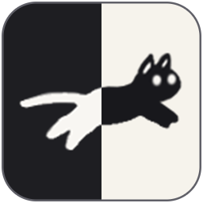
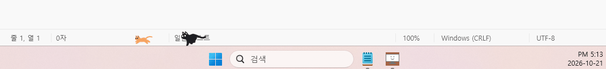
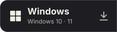
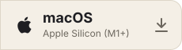
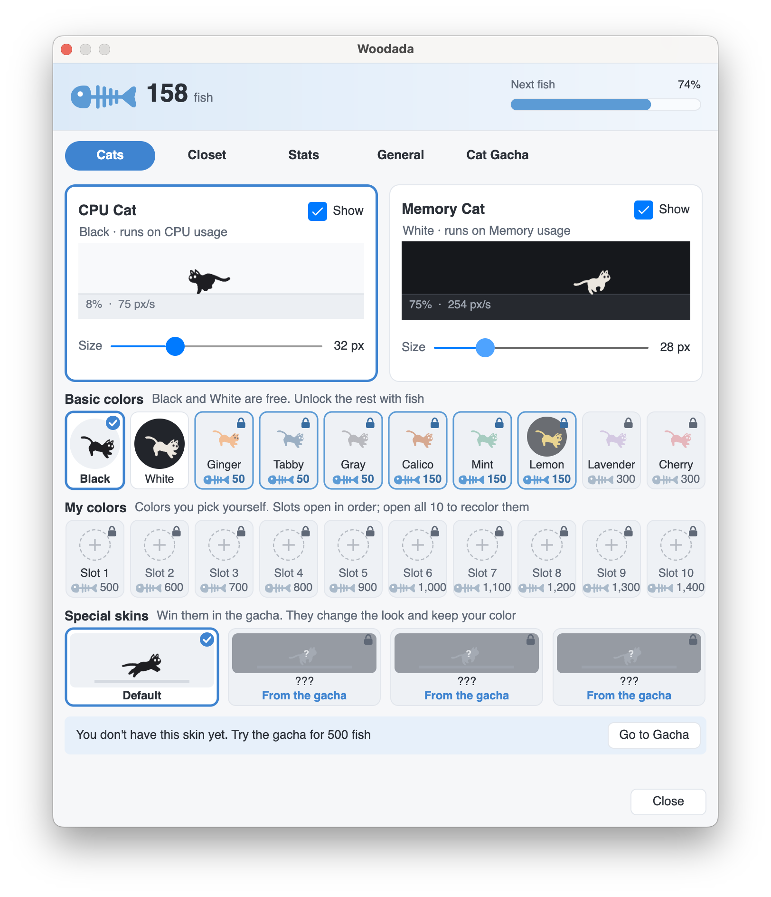

🌐 <b>English</b> · <a href="README.ko.md">한국어</a>

<h1><b>Woodada</b></h1>

**A cat that gets the zoomies on your taskbar**

The busier your computer gets, the faster the cat runs.

    

 

  

<!-- 앱 아이콘처럼 왼쪽 검정(Windows)·오른쪽 크림(macOS) 반반 버튼. 두 링크 사이에 공백이 없어야 한 알약처럼 붙는다. -->

On an Intel Mac? Grab [this one](https://github.com/Hyuntae-Jeong/Woodada/releases/latest/download/Woodada-mac-x64.dmg) instead.

 

## 🐈 What it does

- 🏃 **Runs faster when your computer is busy** — A CPU cat and a memory cat dash back and forth along your taskbar (or the Dock on a Mac).
- 🐟 **Earn fish as they run** — The more they run, the more fish you collect. Spend fish on new colors and new friends.
- 🎨 **Make it yours** — Pick from 20 colors for each cat and change its size.
- 🎰 **Cat Gacha** — Save up fish and try your luck for a special cat.
- 📏 **How far did it run today?** — Distance is based on your monitor's real size, so you'll see things like "1.2 km today".
- 🪶 **Stays out of your way** — Clicks pass right through the cats to the window underneath, and they hide on their own in full-screen apps like games or presentations.
- 🔄 **Always up to date** — Updates itself when a new version comes out.

  

### 🎰 Special cats from the Cat Gacha

| | Cat | What it looks like |
|:-:|---|---|
| ★★ | **Ghost Cat** | Floats along with a see-through body |
| ★★★ | **Flash Cat** | Leaves afterimages and sparks behind. The faster it runs, the longer the trail |
| ★★★★ | **Glitch Cat** | Every now and then it flickers like a broken screen |

A dachshund and a rabbit will be joining the run soon. 🐕 🐇

 

## 📥 Install

### Windows

1. Use the **Windows** button above to download `Woodada.exe`.
2. Put it somewhere handy, like your desktop, and double-click it. There's nothing to install.
3. The cats show up on your taskbar. Click the cat icon in the system tray (bottom right) to open the settings.

> [!TIP]
> If you see a "Windows protected your PC" message, click **More info → Run anyway**.
> Automatic updates won't work if you keep the app in a folder that needs admin rights, like `Program Files`.

### macOS

1. Use the **macOS** button above to download the `.dmg`. (Intel Macs: use the link under the button.)
2. Open the `.dmg` and drag Woodada into your Applications folder.
3. Launch it and the cats show up on your Dock. Open the settings from the cat icon in the menu bar.

> [!TIP]
> If macOS says the app is from an "unidentified developer" the first time you open it, go to **System Settings → Privacy & Security** and click **Open Anyway**. You only need to do this once.

 

## 💬 FAQ

<b>Can it start when I turn on my computer?</b>

 

Yes. Turn on **Start with Windows** (or **Open at Login** on a Mac) from the tray or menu bar icon.

<b>How do I update it?</b>

 

You don't have to. Every time the app starts, it checks for a new version and swaps it in on its own.

<b>I have more than one monitor.</b>

 

Pick which monitor the cats run on in the **General** tab of the settings. They follow your taskbar whether it's at the top, bottom, left, or right.

<b>I hide the Dock on my Mac.</b>

 

If the Dock is hidden or on the side of the screen, the cats run along the bottom of the screen instead.

<b>How do I uninstall it?</b>

 

- **Windows** — Quit from the tray icon, then delete `Woodada.exe`. To erase your records too, delete the `%APPDATA%\Woodada` folder.
- **macOS** — Quit from the menu bar icon, then move Woodada from your Applications folder to the Trash. Your records are in `~/Library/Application Support/Woodada`.

 

## 🙏 Credits

The cat sprites come from [RunCat365](https://github.com/runcat-dev/RunCat365) (runcat-dev, Apache License 2.0).
The dachshund and rabbit were hand-drawn to match the cat's style.
The special gacha skins (Flash, Ghost, Glitch, Ice, Kittens) are original effects designed on top of these cat sprites.

## 📄 License

Woodada is free and open source under the [MIT License](LICENSE), with two exceptions.

- **The cat sprites** follow their original license (Apache License 2.0, [`app/src/Woodada/Assets/RunCat/LICENSE`](app/src/Woodada/Assets/RunCat/LICENSE)).
- **The special skin designs and the dachshund and rabbit characters** are not covered by the MIT License. You're free to use them in official releases, but copying them into other products or distributing modified versions needs permission. The covered files and terms are in [`app/src/Woodada/Sprites/Skins/LICENSE`](app/src/Woodada/Sprites/Skins/LICENSE).
